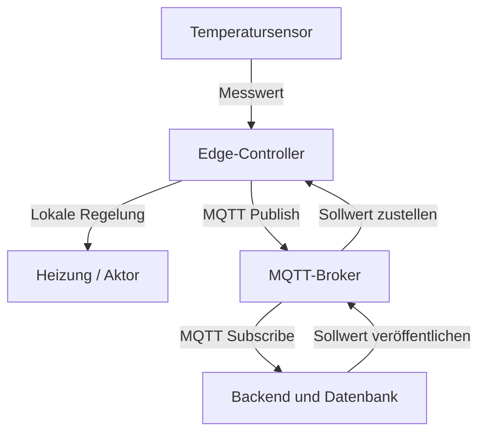

# 07-01: LF 7.1 Vernetzte Systeme, IoT-Architektur & MQTT

Dieses Modul behandelt den Aufbau cyber-physischer Systeme vom Endgerät bis zur zentralen Verarbeitung. Im Mittelpunkt stehen Netzwerkpläne, die begründete Auswahl von Kommunikationsverfahren und die Bewertung der Ausfallsicherheit.

---

## 1. Cyber-physische Systeme (CPS)

**Cyber-physische Systeme** verbinden physische Vorgänge mit Software und Netzwerken. Sensoren erfassen Zustände, Software verarbeitet die Daten und Aktoren beeinflussen die Umgebung. Vernetzte CPS sind eine wichtige Grundlage des Internet of Things (IoT).

| Komponente | Aufgabe | Beispiel |
| :--- | :--- | :--- |
| **Sensor** | Erfasst eine physikalische Größe und stellt sie als elektrisches bzw. digitales Signal bereit. | Temperatursensor |
| **Aktor** | Setzt ein Steuersignal in eine physische Wirkung um. | Ventil, Motor oder Heizung |
| **Controller / Mikrocontroller** | Liest Sensoren aus, verarbeitet Messwerte und steuert Aktoren. | ESP32 oder ein Arduino-Board |
| **Gateway** | Verbindet unterschiedliche Netze; kann Protokolle übersetzen und Daten vorverarbeiten. | BLE-zu-IP-Gateway |
| **Server / Cloud** | Übernimmt zentrale Speicherung, Auswertung und Bereitstellung von Daten. | Backend mit Datenbank und Dashboard |

**Praxisbeispiel:** Ein Sensor misst die Raumtemperatur. Ein Mikrocontroller entscheidet lokal, ob die Heizung eingeschaltet werden soll. Zusätzlich werden Messwerte an ein Backend übertragen.

**FIAE-Bezug:** Entwickler implementieren die Verarbeitungskette: Messwerte einlesen, validieren, übertragen, speichern und in einer Anwendung darstellen.

---

## 2. Systemarchitektur: Edge bis Cloud

* **Edge:** Verarbeitung nahe an der Datenquelle, etwa auf einem Mikrocontroller oder Gateway. Lokale Entscheidungen verkürzen Reaktionszeiten und können auch ohne Internetverbindung funktionieren.
* **Cloud / zentraler Server:** Zusammenführung vieler Datenquellen, langfristige Speicherung und aufwendige Auswertungen. Ein zentraler Server kann auch im lokalen Netzwerk stehen.

### Logischer und physischer Netzwerkplan

| Plan | Zeigt | Typische Angaben |
| :--- | :--- | :--- |
| **Logisch** | Funktionen, Datenflüsse und Kommunikationsbeziehungen | MQTT-Topics, Dienste, Schnittstellen, IP-Netze |
| **Physisch** | Konkrete Geräte, Standorte und Verbindungen | Sensorstandorte, Gateways, Switches, Kabel und Funkstrecken |

### Beispiel: Logische Architektur einer Temperaturregelung



Im **physischen Plan** werden dazu die tatsächlich eingesetzten Geräte und Verbindungen ergänzt: Sensorleitung zum ESP32, WLAN zum Access Point, Ethernet zum Router und die Verbindung zum Server.

Ein separates Gateway ist beispielsweise nötig, wenn ein BLE-Sensor selbst keine IP-Verbindung zum Backend herstellen kann. Bei einem direkt per WLAN angebundenen ESP32 kann diese zusätzliche Protokollbrücke entfallen.

**FIAE-Bezug:** Die Architektur legt fest, welche Funktionen lokal laufen, welche Schnittstellen das Backend benötigt und wie sich die Anwendung bei Verbindungsabbrüchen verhält.

---

## 3. Kommunikationsverfahren begründet auswählen

Das **IoT-Dreieck** beschreibt einen Zielkonflikt zwischen Reichweite, Datenrate und Energieeffizienz. Die passende Technik ergibt sich aus den Anforderungen des Szenarios.

Zusätzlich sind Latenz, Zuverlässigkeit, Infrastruktur und Kosten zu berücksichtigen. Übertragungstechnik und Anwendungsprotokoll sind zu unterscheiden: WLAN stellt beispielsweise den Netzzugang bereit; MQTT regelt darüber den Nachrichtenaustausch.

| Technik | Reichweite / Datenrate | Energiebedarf | Typischer Einsatz |
| :--- | :--- | :--- | :--- |
| **WLAN / Wi-Fi** | Lokales Netz; vergleichsweise hohe Datenrate | Häufig höher als bei BLE oder Zigbee; abhängig von Betriebsart und Sendehäufigkeit | Kameras, Geräte mit Netzstrom, größere Datenmengen |
| **Bluetooth Low Energy (BLE)** | Lokale Funkverbindungen; Reichweite und Datenrate abhängig von Funkmodus und Umgebung | Gering bei kurzen, seltenen Übertragungen | Batteriesensoren, Wearables |
| **Zigbee** | Geringe Datenrate; Mesh kann die Netzabdeckung erweitern | Gering bei schlafenden Endgeräten; Router müssen verfügbar bleiben | Gebäudeautomation, vernetzte Sensoren |
| **LoRaWAN** | Große Reichweite, oft mehrere Kilometer; geringe Datenrate | Für kleine, seltene Nachrichten sehr gering | Entfernte Umwelt- oder Füllstandssensoren |
| **KNX / PROFINET** | Je nach System und Medium unterschiedlich | Häufig feste Stromversorgung | KNX: Gebäudeautomation; PROFINET: industrielle Automatisierung |

### Wichtige Einordnungen

* WLAN ist für Batteriegeräte **nicht grundsätzlich ungeeignet**. Schlafmodi und seltenes Senden können den Verbrauch senken.
* Zigbee bietet keine hohe Datenrate; seine Stärken liegen bei kleinen Nachrichten und vernetzten Geräten.
* LoRaWAN ist nicht pauschal auf „wenige Bytes pro Stunde“ begrenzt. Nutzdatenmenge und Sendehäufigkeit hängen unter anderem von Datenrate, Funkregeln und Netzvorgaben ab.
* KNX und PROFINET sind keine gleichwertigen Echtzeitlösungen. PROFINET bietet unterschiedliche Echtzeitverfahren; harte Zeitvorgaben erfordern eine dafür ausgelegte Infrastruktur und Konfiguration.

### Auswahlbeispiele

| Anforderung | Begründete Auswahl |
| :--- | :--- |
| Batteriebetriebener Sensor auf einem entfernten Feld; Messung alle 15 Minuten | **LoRaWAN:** kleine Datenmenge, große Reichweite und lange Schlafphasen |
| Mehrere Raumsensoren in einem Gebäude | **Zigbee oder BLE:** geringe Datenmengen; Netzabdeckung und Gateway-Anbindung prüfen |
| Kamera mit kontinuierlichem Videostream | **WLAN oder Ethernet:** hohe Datenrate; Stromversorgung einplanen |
| Zeitkritische industrielle Steuerung | **Geeignetes industrielles Echtzeitnetz:** Anforderungen an Zykluszeit und Verfügbarkeit konkret prüfen |

**FIAE-Bezug:** Die Auswahl beeinflusst Nachrichtenformat, Sendeintervalle, Zeitlimits, Wiederholungen und den Umgang mit verspäteten Daten im Backend.

---

## 4. MQTT: Publish / Subscribe

**MQTT** ist ein leichtgewichtiges Anwendungsprotokoll für nachrichtenbasierte Kommunikation, typischerweise über TCP/IP.

* **Publisher:** Veröffentlicht eine Nachricht unter einem Topic.
* **Subscriber:** Abonniert Topics und empfängt passende Nachrichten.
* **Broker:** Nimmt Veröffentlichungen entgegen und verteilt sie an berechtigte Abonnenten.

Die MQTT-Nachrichten laufen über den Broker. Geräte müssen dafür die Adressen anderer Teilnehmer nicht kennen. Ein Client kann gleichzeitig veröffentlichen und abonnieren.

### Topics und Nutzdaten

Topics strukturieren Nachrichten hierarchisch:

```text
gebaeude/etage1/raum101/temperatur
gebaeude/etage1/raum101/luftfeuchtigkeit
gebaeude/etage2/raum201/temperatur
gebaeude/etage3/raum301/temperatur
```

Beispiel für die Nutzdaten einer Temperaturmeldung:

```json
{
  "sensor_id": "raum101",
  "temperatur_c": 22.4
}
```

Ein Dashboard kann `gebaeude/+/+/temperatur` abonnieren. Das Platzhalterzeichen `+` steht jeweils für genau eine Topic-Ebene.

**FIAE-Bezug:** Entwickler entwerfen Topic-Strukturen und Datenformate und programmieren Publisher, Subscriber und die Weiterverarbeitung eingehender Nachrichten.

---

## 5. MQTT Quality of Service (QoS)

QoS beschreibt die Zustellsemantik einer MQTT-Nachricht zwischen den jeweiligen Protokollteilnehmern.

| QoS | Bedeutung | Konsequenz | Aufwand |
| :--- | :--- | :--- | :--- |
| **0 – At most once** | Höchstens einmal | Keine MQTT-Zustellbestätigung; Verlust möglich | Gering |
| **1 – At least once** | Mindestens einmal | Bestätigung und Wiederholung; Duplikate möglich | Mittel |
| **2 – Exactly once** | Genau einmal auf der jeweiligen MQTT-Verbindung | Zusätzlicher Austausch verhindert doppelte Zustellung auf dieser Verbindung | Höher |

**Beispiele:**

* Ein häufig wiederholter Temperaturwert kann mit **QoS 0** übertragen werden, wenn einzelne Ausfälle akzeptabel sind.
* Ein Ereignis, das zuverlässig ankommen soll, kann **QoS 1** nutzen. Die Anwendung muss mögliche Duplikate berücksichtigen.
* **QoS 2** kommt infrage, wenn die einmalige Zustellung auf der MQTT-Verbindung den zusätzlichen Aufwand rechtfertigt.

**Wichtig:** QoS garantiert weder eine feste Reaktionszeit noch die erfolgreiche Verarbeitung oder Speicherung im Backend. Publisher–Broker und Broker–Subscriber sind getrennte Übertragungsstrecken. Verbindungs-, Sitzungs- und Speicherbedingungen beeinflussen das Verhalten bei Ausfällen.

**FIAE-Bezug:** Bei QoS 1 helfen eindeutige Ereignis-IDs und idempotente Verarbeitung: Eine wiederholte Nachricht darf keine unbeabsichtigte zweite Buchung oder Aktion auslösen.

---

## 6. Ausfallsicherheit und Single Points of Failure

Ein **Single Point of Failure (SPOF)** ist eine einzelne Komponente, deren Ausfall eine benötigte Funktion lahmlegt.

| Möglicher SPOF | Auswirkung | Mögliche Verbesserung |
| :--- | :--- | :--- |
| Gateway | Dahinterliegende Sensoren erreichen das Backend nicht mehr. | Ersatzgerät oder redundante Anbindung, soweit technisch unterstützt |
| MQTT-Broker | Nachrichten können nicht mehr zentral verteilt werden. | Überwachung, automatischer Neustart oder unterstützte Hochverfügbarkeitslösung |
| Router / Internetzugang | Cloud-Verbindung fällt aus. | Lokale Verarbeitung und Zwischenspeicherung; bei Bedarf zweite Verbindung |
| Datenbank | Messwerte können nicht gespeichert oder abgefragt werden. | Replikation für Verfügbarkeit; Backups für Wiederherstellung |
| Gemeinsame Stromversorgung | Mehrere Komponenten fallen gleichzeitig aus. | USV und geeignete Trennung der Versorgung |

**Bewertung:** Redundanz erhöht Kosten und Komplexität. Sie sollte sich an den Folgen eines Ausfalls orientieren. Zwei Geräte am selben ausgefallenen Netzteil beseitigen diesen gemeinsamen SPOF nicht.

**Softwaremaßnahmen:** Wiederverbindung mit Warteintervallen, begrenzte lokale Puffer, Überwachung und die Erkennung veralteter Messwerte. Beim Nachsenden müssen Zeitstempel, Reihenfolge und Duplikate berücksichtigt werden.

---

## FIAE-Zusammenfassung

Anwendungsentwickler verbinden Gerätekommunikation mit verlässlicher Softwareverarbeitung:

1. **Architektur dokumentieren:** Komponenten, Datenflüsse und physische Verbindungen nachvollziehbar darstellen.
2. **Kommunikation auswählen:** Reichweite, Datenrate, Latenz und Energiebedarf gegen die Anforderungen abwägen.
3. **Schnittstellen entwerfen:** MQTT-Topics und einheitliche Nachrichtenformate festlegen.
4. **Daten verarbeiten:** Eingaben prüfen, Duplikate behandeln und Messwerte speichern.
5. **Ausfälle berücksichtigen:** Lokale Funktionen, Pufferung und Wiederverbindung einplanen.

**Merksatz:** Eine IoT-Anwendung besteht aus dem Zusammenspiel von Geräten, Netzwerk und Software. Die Architektur muss sowohl zum Normalbetrieb als auch zum Verhalten bei Ausfällen passen.

---

## Quellen zur fachlichen Vertiefung

* [OASIS: MQTT Version 5.0](https://docs.oasis-open.org/mqtt/mqtt/v5.0/os/mqtt-v5.0-os.html)
* [HiveMQ: MQTT Quality of Service](https://www.hivemq.com/blog/mqtt-essentials-part-6-mqtt-quality-of-service-levels/)
* [LoRa Alliance: About LoRaWAN](https://lora-alliance.org/about-lorawan/)
* [Bluetooth SIG: Technology Overview](https://www.bluetooth.com/learn-about-bluetooth/tech-overview/)
* [Connectivity Standards Alliance: Zigbee](https://csa-iot.org/all-solutions/zigbee/)
* [PROFIBUS & PROFINET International: PROFINET](https://www.profibus.com/profinet-technology)

